<div align="center">


# bussola

**Review pull requests one function at a time, on your own machine.**

Approvals that survive rebases, an AI reviewer that ranks what it finds,
and comments that go straight back to GitHub.

<a href="https://github.com/Spoki-App/bussola/actions/workflows/ci.yml"></a>
<a href="https://pypi.org/project/bussola/"></a>

<a href="https://github.com/Spoki-App/bussola/blob/main/LICENSE"></a>

[Quick start](#quick-start) · [Features](#features) · [AI review](#ai-review) · [Guide](https://github.com/Spoki-App/bussola/blob/main/docs/GUIDE.md) · [FAQ](#faq)

<picture>
  <source media="(prefers-color-scheme: dark)" srcset="https://raw.githubusercontent.com/Spoki-App/bussola/main/docs/assets/hero-dark.svg">
  
</picture>

**[▶ Watch the 2-minute video tour](https://youtu.be/-FeO_eDhOrU)**

</div>

## Why

GitHub shows a pull request as a long list of files, and every force-push makes you read them again. bussola shows it the way you read code: as the **functions, methods, classes and module code** it touches, each with its own diff and its own **Approve** button. Approvals belong to the code, not to a commit, so after a rebase you only look at what really changed.

| | GitHub "Files changed" | bussola |
|---|---|---|
| You approve | a file, as **Viewed** | a function, method, class or module code |
| After a force-push | a file is unmarked if anything in it changed | only units whose code changed need another look |
| Approved code changes | you read the file again | you see the diff from the version you approved |
| Runs on | github.com | your machine, on your local clone |

*Bussola* is Italian for compass: it helps you find your way through a large change.

## Quick start

```bash
uv tool install bussola
cd path/to/your/repository
bussola serve
```

The browser opens on your repository. Type a branch on its card and press **Start review**, or paste a pull request link in **Settings** > **Open pull request**. Then `n` jumps to the next unit to review and `a` approves it.

You need Python 3.12+ and git, plus the [GitHub CLI](https://cli.github.com) signed in with `gh auth login` for pull requests. `pipx install bussola` works too. Tested on macOS and Linux; Windows is not tested yet.

## Features

| Feature | What you get |
|---|---|
| **[Review by unit](https://github.com/Spoki-App/bussola/blob/main/docs/FEATURES.md#review-by-unit-not-by-file)** | Functions, methods, classes, types and module code, parsed with tree-sitter for Python, TypeScript, JavaScript and Go. Other files are reviewed whole, a few lines at a time if you like. |
| **[Approvals that follow the code](https://github.com/Spoki-App/bussola/blob/main/docs/FEATURES.md#approvals-that-follow-the-code)** | After a rebase or a force-push, unchanged units stay approved, a renamed function keeps its approval, and a changed one shows the diff from what you approved. |
| **[AI reviewer](https://github.com/Spoki-App/bussola/blob/main/docs/FEATURES.md#an-ai-reviewer-that-ranks-what-it-finds)** | Optional. Reads the whole pull request, follows the code with your same lookups, and leaves line comments ranked 🔴 Critical to 🔵 Low, each with a fix. Ask the AI chat about any line, and it adds comments when you ask. |
| **[Editor-like navigation](https://github.com/Spoki-App/bussola/blob/main/docs/FEATURES.md#navigate-like-in-your-editor)** | Cmd+click (Ctrl+click) a name for its definition or usages. Library names show their documentation. |
| **[Moved code, found](https://github.com/Spoki-App/bussola/blob/main/docs/FEATURES.md#moved-code-found-for-you)** | Moved or extracted code is linked both ways, and marked **identical** when it did not change. Compare any two ranges, or a range with the clipboard. |
| **[GitHub, both ways](https://github.com/Spoki-App/bussola/blob/main/docs/FEATURES.md#github-both-ways)** | Open a pull request from its link, reply to its comments, submit **Comment**, **Approve** or **Request changes**, and **Merge**. No GitHub? Review any two local branches. |
| **[Long reading sessions](https://github.com/Spoki-App/bussola/blob/main/docs/FEATURES.md#made-for-long-reading-sessions)** | Changed words marked, split or unified diffs, line wrap, your code font, a shortcut for everything, and the themes you already have in VS Code, Cursor or Windsurf. |
| **[Local and private](https://github.com/Spoki-App/bussola/blob/main/docs/FEATURES.md#local-and-private)** | One SQLite file on your machine, a server on `127.0.0.1` with a session token, network only when you ask. |

**[See every feature in action, with how to use it →](https://github.com/Spoki-App/bussola/blob/main/docs/FEATURES.md)**

## Everyday use

In the review page:

| Key | Action |
|---|---|
| `n` | next unit to review |
| `j` / `k` | next / previous unit |
| `a` | approve or revoke the unit, or the selected lines |
| `c` | comment |
| `r` | **Sync**: fetch new commits, send your comments to GitHub |
| `t` | show or hide the conversation |
| Cmd/Ctrl+click | go to definition or list usages |

From the terminal:

| Command | What it does |
|---|---|
| `bussola serve` | Register the repository in the current folder and open the browser. Options: `--repo`, `--port`, `--no-open`. |
| `bussola status <branch>` | Refresh a branch review and print the state of each unit. |
| `bussola refresh <branch> --fetch` | Fetch, then record a new revision if commits changed. |
| `bussola install-handler` | Open `bussola://` links from GitHub, Slack or a terminal. |
| `bussola --install-completion` | Tab completion for commands, options and branch names. |

Optional `.bussola.toml` at the repository root:

```toml
base_branch = "develop"
file_level = ["**/migrations/*.py", "*.lock", "package-lock.json", "pnpm-lock.yaml", "*.min.js"]
ignore = ["vendor/**", "docs/**"]
```

`file_level` files are reviewed whole instead of parsed (setting it replaces the defaults above), and `ignore` files are left out of the review.

Every option is in the [guide](https://github.com/Spoki-App/bussola/blob/main/docs/GUIDE.md).

## AI review

Off until you choose a provider in **Settings** > **AI**. **AI review** comments on the whole pull request, **AI chat** answers your questions and adds comments when you ask, **Describe** explains a unit, **Rate impact** sorts units by **High**, **Medium** or **Low** impact, and you can rewrite the prompts.

| Provider | Key | |
|---|---|---|
| Claude Code CLI | none: the `claude` you are signed in to | runs in safe mode in an empty folder, so it cannot touch your files |
| Anthropic API | `ANTHROPIC_API_KEY` | default model `claude-opus-5-5` |
| OpenAI-compatible | optional | Ollama, LM Studio, vLLM or a hosted endpoint |

- **Nothing leaves your machine** until you start an AI action, and then only the code it works on. The first time, bussola names the provider and waits for **Send code**.
- **Keys stay in environment variables.** bussola never writes them anywhere.
- **Only you pick the provider.** A repository can turn AI off in its `.bussola.toml`, never on or somewhere else.

Models, endpoints, limits and prompts: [AI providers](https://github.com/Spoki-App/bussola/blob/main/docs/GUIDE.md#ai-providers).

## Privacy and security

- **Local.** Reviews, approvals and comments live in one SQLite file on your machine. Code is read only from git, never from your working tree.
- **Locked to you.** The server listens on `127.0.0.1`, every call needs a session token, and requests for other hosts are rejected.
- **Quiet.** The network is used only for `git fetch`, `gh` (when you sync, or every few minutes while a pull request review is open) and the AI provider you chose.
- **No tokens stored.** GitHub goes through your own `gh` login.

Details: [Security](https://github.com/Spoki-App/bussola/blob/main/docs/GUIDE.md#security) and [Data](https://github.com/Spoki-App/bussola/blob/main/docs/GUIDE.md#data). Report vulnerabilities privately: [SECURITY.md](https://github.com/Spoki-App/bussola/blob/main/SECURITY.md).

## Status

Used on real pull requests, but young: until 1.0, commands, options and the UI may change between minor versions. Your data is kept across upgrades, and the database migrates itself at startup. What changed: [CHANGELOG.md](https://github.com/Spoki-App/bussola/blob/main/CHANGELOG.md).

## FAQ

<details><summary><b>Does my code leave my machine?</b></summary>

No. bussola reads your local clone, talks to your git remote when you sync and to GitHub through your `gh` login. With an AI provider, the code of an AI action goes to that provider when you start it: see [what leaves your machine](https://github.com/Spoki-App/bussola/blob/main/docs/GUIDE.md#what-leaves-your-machine).
</details>

<details><summary><b>Do I need GitHub?</b></summary>

No. Any two branches of a local repository can be reviewed. GitHub adds pull request listing, comment import and sending comments back.
</details>

<details><summary><b>Does it replace GitHub's review UI?</b></summary>

It is a place to do the reading. Approvals stay with you and follow the code across force-pushes; comments go back to the pull request, where your team discusses them.
</details>

<details><summary><b>Can several people review the same branch?</b></summary>

Yes. Each person runs bussola on their own machine with their own approvals, and comments are shared through the pull request.
</details>

<details><summary><b>What about other languages?</b></summary>

Files that are not parsed are still reviewed, as whole files with line selections. A new language is a tree-sitter extractor in `src/bussola/units/extractors/`: see [CONTRIBUTING.md](https://github.com/Spoki-App/bussola/blob/main/CONTRIBUTING.md).
</details>

## Contributing

Bug reports, ideas and pull requests are welcome. [CONTRIBUTING.md](https://github.com/Spoki-App/bussola/blob/main/CONTRIBUTING.md) has the setup and the checks, [docs/design.md](https://github.com/Spoki-App/bussola/blob/main/docs/design.md) how units, approvals, threads and the GitHub sync work.

## License

[MIT](https://github.com/Spoki-App/bussola/blob/main/LICENSE). Not affiliated with GitHub; GitHub is a trademark of GitHub, Inc. The UI bundles third-party libraries, listed in `THIRD_PARTY_LICENSES.md` next to the app; diagrams use [elkjs](https://github.com/kieler/elkjs) (EPL-2.0).
