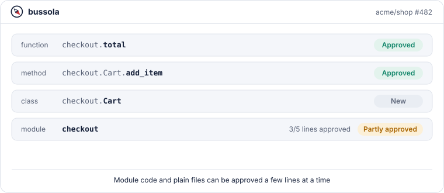
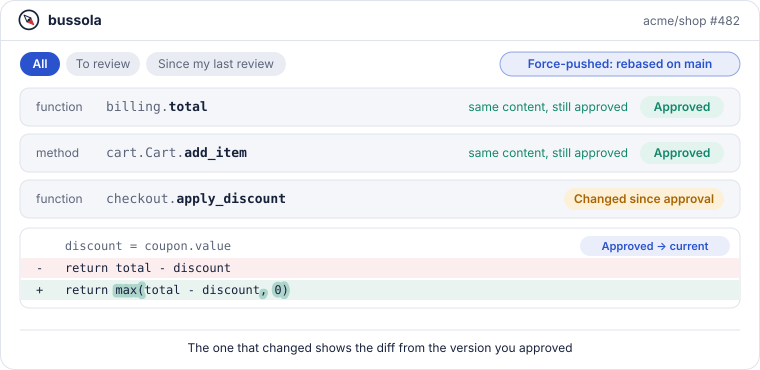
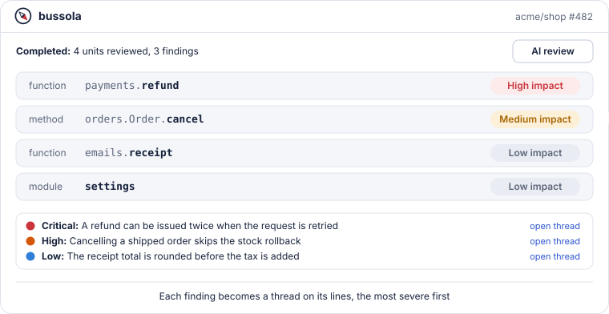
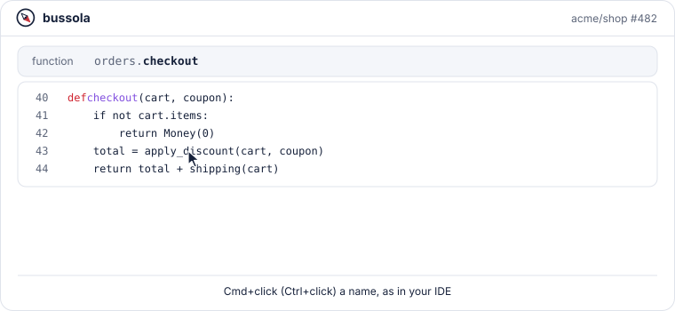
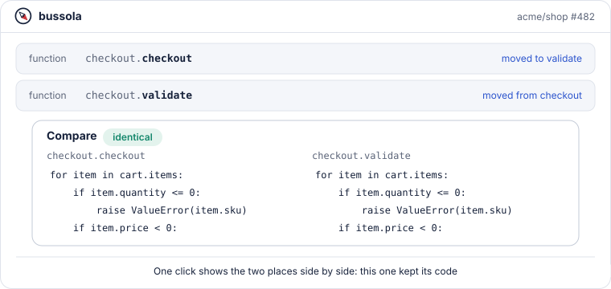
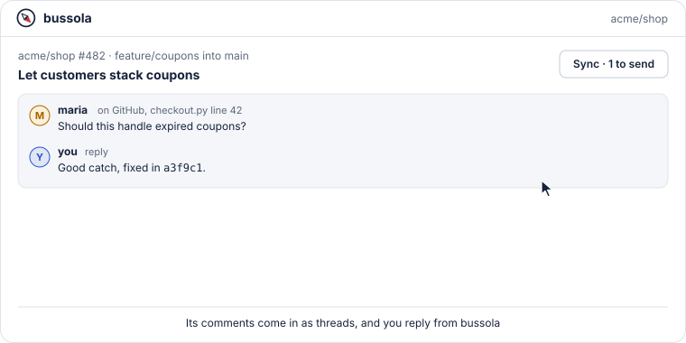
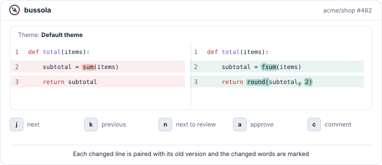
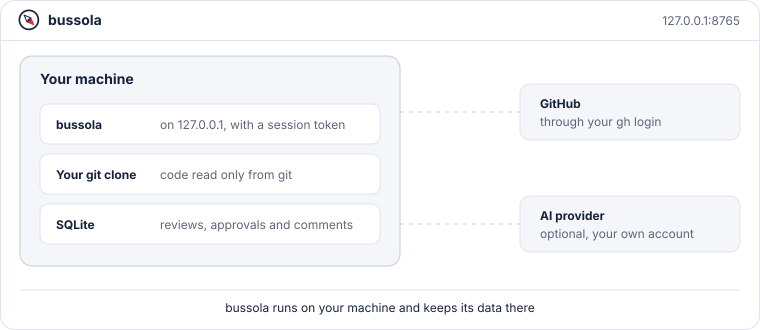

# bussola features

Everything bussola does, one feature at a time: what it is, what it looks like and how to use it. For every option and detail, see the [README](../README.md).

- [Review by unit, not by file](#review-by-unit-not-by-file)
- [Approvals that follow the code](#approvals-that-follow-the-code)
- [An AI reviewer that ranks what it finds](#an-ai-reviewer-that-ranks-what-it-finds)
- [Navigate like in your editor](#navigate-like-in-your-editor)
- [Moved code, found for you](#moved-code-found-for-you)
- [GitHub, both ways](#github-both-ways)
- [Made for long reading sessions](#made-for-long-reading-sessions)
- [Local and private](#local-and-private)

## Review by unit, not by file

GitHub shows a pull request as a list of files. bussola splits every change into the units you think in: functions, methods, class bodies, TypeScript and Go types, and module-level code. Python, TypeScript, TSX, JavaScript and Go are parsed with tree-sitter; every other file is reviewed whole. Each unit has its own diff, its own state and its own **Approve** button, and a progress bar shows how much is left.

<picture>
  <source media="(prefers-color-scheme: dark)" srcset="assets/features/units-dark.svg">
  
</picture>

### How to use it

1. Run `bussola serve` inside your repository. The browser opens on its card.
2. Type the branch to review on the card and press **Start review**, or open a pull request (see [GitHub, both ways](#github-both-ways)).
3. Read a unit and press **Approve**, or `a` on the keyboard. Its card closes and `n` takes you to the next unit that needs review.
4. For module code or a whole file, click a changed line, shift-click another one or drag over the line numbers to select a range, then press **Approve selection**.
5. Use the filters in the **Files** bar (**All**, **To review**, impact) and the search box to find a unit by module, name or path.

Files that should never be parsed or reviewed can be listed in `.bussola.toml` with `file_level` and `ignore`.

More in the README: [Reviewing](../README.md#reviewing), [Configuration](../README.md#configuration).

## Approvals that follow the code

An approval belongs to the content of a unit, not to a commit. After new commits, a rebase or a force-push, a unit with the same code stays approved, and a function renamed with the same body keeps its approval. A unit you approved that changed again comes back as **Changed since approval**, with the diff from the version you approved instead of the whole change.

<picture>
  <source media="(prefers-color-scheme: dark)" srcset="assets/features/approvals-dark.svg">
  
</picture>

### How to use it

1. Approve units as you read them.
2. When the branch moves, press **Sync** (`r`). It fetches the branch and records the new commits; an open review page also picks up new revisions by itself.
3. Units whose code did not change stay **Approved**. The others show **Changed since approval** and open on the **Approved → current** diff; switch to **Base → head** to see the whole change.
4. When you finish a pass, press **Mark as reviewed**. Next time, the **Since my last review** filter shows only what appeared or changed after that point.

Approvals stay on your machine. On a pull request, **Sync** ticks **Viewed** on GitHub for every file whose changes you have all approved.

More in the README: [Reviewing](../README.md#reviewing).

## An AI reviewer that ranks what it finds

Optional, and off until you choose a provider. **AI review** sends the pull request as a whole, with its description and the comments already made, and lets the model follow the code with the same lookups you use: definitions, usages, any file, a text search. Each problem it finds becomes a thread on its lines, starting with its severity (🔴 Critical, 🟠 High, 🟡 Medium, 🔵 Low) and ending with a fix, and the same answer rates the impact of every unit.

<picture>
  <source media="(prefers-color-scheme: dark)" srcset="assets/features/ai-review-dark.svg">
  
</picture>

### How to use it

1. Open **Settings** > **AI** and choose a provider: **Claude Code CLI** (uses the `claude` command you are already signed in to, no key), **Anthropic API** (reads `ANTHROPIC_API_KEY`) or an **OpenAI-compatible endpoint**.
2. On the review page, press **AI review**. The page shows how many units are done; **Cancel** stops it and keeps the findings already added.
3. Read the findings as threads with an **AI** badge: reply, resolve or delete them like any other thread. **Details** shows the summary, every code lookup and the units reviewed.
4. Use the impact filter in the **Files** bar (**High**, **Medium**, **Low**) to start from the units that matter, or press **Rate impact** to rate them without a review.
5. Press **Describe** on a unit card for an explanation of the unit and its change, with links to the lines it talks about.
6. To ask your own questions, open **AI chat** in the panel on the right. Select lines by their numbers and choose **Ask AI** to attach them to the next message; the model can look up definitions, usages and files to answer.

**AI prompts** in **Settings** changes what the model is told for **Describe**, **Rate impact** and **AI review**, for example to focus on security. Running **AI review** again only reviews the units that changed since; **Review all** (or **Review again** once every unit has an AI review) reviews everything once more.

More in the README: [AI providers](../README.md#ai-providers), [AI review](../README.md#ai-review), [AI chat](../README.md#ai-chat), [What leaves your machine](../README.md#what-leaves-your-machine).

## Navigate like in your editor

Cmd+click (Ctrl+click on Linux and Windows) a name in any diff to go where it is defined or list where it is used, in Python, TypeScript, TSX, JavaScript and Go. Results inside the review scroll to the unit and highlight the line; results elsewhere open the file at the reviewed commit. Names from frameworks and libraries show their documentation and a link to it.

<picture>
  <source media="(prefers-color-scheme: dark)" srcset="assets/features/navigation-dark.svg">
  
</picture>

### How to use it

1. Hold Cmd (Ctrl). The name under the pointer is underlined when it has somewhere to go.
2. Click a call or any use of a name to go to its definition. With one result it opens directly; with several, a list opens next to the pointer.
3. Click a name where it is defined to list its usages, grouped by file, each with the function, method or class it lives in.
4. Without Cmd, a plain click on a name highlights every occurrence of it in the unit.

It works with nothing installed, from an index built in the background. When `basedpyright`, `typescript-language-server` or `gopls` is on your `PATH`, its more precise answers are used instead.

More in the README: [Code navigation](../README.md#code-navigation).

## Moved code, found for you

When code is moved or extracted, the diff shows a deletion here and an addition there. bussola matches the two blocks, also across files, and links them both ways with **moved to** and **moved from**. Moves that kept the code as it was, apart from indentation and blank lines, are marked **identical**, so you do not read them twice. You can also compare any two pieces of code yourself, or a piece of code with what you copied to the clipboard.

<picture>
  <source media="(prefers-color-scheme: dark)" srcset="assets/features/moves-dark.svg">
  
</picture>

### How to use it

1. Look for **moved to** and **moved from** next to a unit's title, and click one to see the two blocks side by side with the changed words marked.
2. To compare two ranges, select lines by their numbers as for a comment and choose **Compare with...**, then select the second range anywhere in the review and choose **Compare with first range**. **Cancel** in the bar at the bottom drops the first range.
3. To compare with code from elsewhere, copy it, select the lines and choose **Compare with clipboard**. The copied code is lined up with the indentation of your lines; the browser may ask once to let the page read the clipboard.

Small blocks and trivial lines such as `}` or `else:` are left out of move detection, so common snippets do not show up as moves.

More in the README: [Comparing code](../README.md#comparing-code).

## GitHub, both ways

bussola reads and writes pull requests through your own GitHub CLI login. Open any pull request from its link, bring in its comments as threads, reply, resolve, and send everything back as one review with **Comment**, **Approve** or **Request changes**. You can also merge from the review page. Without GitHub, any two branches of a local repository can be reviewed.

<picture>
  <source media="(prefers-color-scheme: dark)" srcset="assets/features/github-dark.svg">
  
</picture>

### How to use it

1. Install the [GitHub CLI](https://cli.github.com) and sign in with `gh auth login`.
2. Open a pull request: **Pull requests** on a repository card, **Settings** > **Open pull request** with its link, or a `bussola://` link (run `bussola install-handler` once to register them).
3. Comments already on GitHub appear as threads on their lines. Reply, write with Markdown, mention people with `@` and attach images.
4. Press **Sync** to send what you wrote; the button shows how many comments are waiting.
5. Press **Submit review** to finish with a summary and **Comment**, **Approve** or **Request changes**, and **Merge** when the pull request is ready.

bussola contacts GitHub only when you press one of these buttons, or every few minutes while a pull request review is open, to keep its comments in sync.

More in the README: [Reviewing GitHub pull requests](../README.md#reviewing-github-pull-requests), [Opening bussola:// links](../README.md#opening-bussola-links), [Sending comments to GitHub](../README.md#sending-comments-to-github).

## Made for long reading sessions

Diffs are highlighted like on GitHub, each changed line is paired with its old version and the words that changed are marked, down to the part of a renamed name. Split and unified layouts adapt to the window, long lines wrap, and every action has a shortcut. bussola picks up the themes installed in VS Code, Cursor, Windsurf and VSCodium, with no import step.

<picture>
  <source media="(prefers-color-scheme: dark)" srcset="assets/features/reading-dark.svg">
  
</picture>

### How to use it

1. Open **Settings** > **Appearance** to choose a **Theme** (System, Light, Dark or one from your editor), adjust single **Theme colors**, and set your **Code font** with ligatures.
2. Open **Settings** > **Diff** to choose the **Diff layout** (Automatic, Split, Unified) and **Line wrap**.
3. Learn the shortcuts: `j` / `k` next and previous unit, `n` next unit to review, `a` approve, `c` comment, `r` sync, `t` show or hide the conversation.

Every choice is kept in your browser, so a reload or another review opens the same way.

More in the README: [Reviewing](../README.md#reviewing), [Themes](../README.md#themes).

## Local and private

bussola is a local app for one person. It serves the UI on `127.0.0.1` behind a session token, reads code only from your git clone, and keeps reviews, approvals and comments in a SQLite file on your machine. It goes on the network only when you ask: `git fetch` when you sync, `gh` for pull requests, and an AI provider only for the AI features you use.

<picture>
  <source media="(prefers-color-scheme: dark)" srcset="assets/features/local-dark.svg">
  
</picture>

### How to use it

1. Nothing to set up: run `bussola serve` and use the printed link, which carries the session token.
2. Set `BUSSOLA_DATA_DIR` to keep the database somewhere else.
3. Leave the AI **Provider** on **Off** if no code should leave your machine; with a provider, only the units under review and what the model looks up are sent.

The server warns when it listens on anything other than `127.0.0.1`, and rejects requests for other hosts to block DNS rebinding.

More in the README: [Data](../README.md#data), [Security](../README.md#security), [What leaves your machine](../README.md#what-leaves-your-machine).
